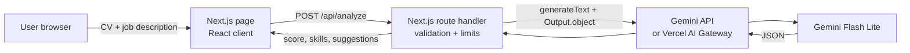

# AI CV Analyzer

Paste a CV and a job description, and an LLM returns a **match score (0-100)**, the **matched skills**, the **missing skills** and **3-5 concrete suggestions** to improve the fit.

**Live demo:** https://ai-cv-analyzer-pink.vercel.app

## Features

- Structured output validated with a Zod schema (score, matched skills, missing skills, suggestions)
- Server-side LLM call to the Google Gemini API (`gemini-3.5-flash-lite`), with the Vercel AI Gateway as an alternative: no API key in the repo or in the browser
- Input length limits (CV 8,000 chars, job 5,000 chars) and a capped output size to keep costs low
- Basic prompt-injection guard: the texts are wrapped in tags and the model is told to ignore instructions inside them
- No database: texts are not stored

## Architecture



## Tech stack

- [Next.js](https://nextjs.org) (App Router) + TypeScript
- [Tailwind CSS](https://tailwindcss.com)
- [AI SDK](https://ai-sdk.dev) (`generateText` with `Output.object`) + [Zod](https://zod.dev)
- [Google Gemini API](https://ai.google.dev) via `@ai-sdk/google` (`gemini-3.5-flash-lite`), or the [Vercel AI Gateway](https://vercel.com/docs/ai-gateway) (`google/gemini-3.1-flash-lite`)
- Deployed on [Vercel](https://vercel.com) (deploys on every push to `main`)

## API

`POST /api/analyze` with `{ "cv": "...", "job": "..." }` returns:

```json
{
  "matchScore": 72,
  "matchedSkills": ["TypeScript", "React"],
  "missingSkills": ["Docker"],
  "suggestions": ["Add a project that uses Docker", "..."],
  "model": "gemini-3.5-flash-lite"
}
```

## Evaluation

The analysis is checked with a small offline-labelled eval suite in [`evals/`](evals/): 26 synthetic CV + job pairs, split into a **dev set (14)** used to find and fix problems and a **held-out set (12)** used only to check the fix.

**Method.** Each case has labels: an expected score range, the skills that must be reported as missing, skills the CV already has (must not be reported as missing) and "A or B" requirement groups. `npm run eval -- dev` (or `heldout`) calls the same `analyzeCv` function the API uses and scores every output for valid schema, score in range, missing-skill recall, false gaps, split OR groups and grounding (reported skills must appear in the job text). Raw outputs are saved in [`evals/runs/`](evals/runs/), and `npm run eval:report` builds [`evals/results.md`](evals/results.md).

**Measured failure.** On the dev baseline the model split "either/or" requirements into separate gaps: for *"Flutter or React Native, Dart or TypeScript"* it listed all four as missing, and for *"SIEM (Splunk or Sentinel)"* it reported Sentinel as missing although the CV has Splunk. 3 of 4 OR groups were split and 1 case had a false gap. The held-out baseline showed the same problem (3 of 7 OR groups split, 2 cases with false gaps).

**Fix.** One prompt change in [`lib/analyze.ts`](lib/analyze.ts): alternatives are treated as one requirement. If the candidate has any option it counts as matched, otherwise the requirement is listed once as "A or B".

**Results** (`gemini-3.5-flash-lite`, one run per configuration):

| Metric | Dev before | Dev after | Held-out before | Held-out after |
|---|---|---|---|---|
| Valid schema | 100% | 100% | 100% | 100% |
| Score in labelled range | 100% | 100% | 100% | 100% |
| Missing-skill recall | 100% | 100% | 100% | 100% |
| Split OR groups | 3/4 | 0/4 | 3/7 | 0/7 |
| Cases with false gaps | 1/14 | 0/14 | 2/12 | 0/12 |
| Match precision | 97.6% | 97.6% | 100% | 100% |

Limitations: the dataset is small and synthetic, each configuration ran once, and the held-out OR cases were written after the failure was found (but before any held-out run). Full per-case numbers are in [`evals/results.md`](evals/results.md).

CI ([`.github/workflows/ci.yml`](.github/workflows/ci.yml)) runs the type check, offline tests (schema, input limits and the eval scorer with mock model responses) and the build, with no API key.

## Running it yourself

Requires Node.js 22+. Run `npm install` and `npm run dev`. `npm test` runs the offline checks; `npm run eval -- dev` needs a model key. Outside Vercel, set `AI_GATEWAY_API_KEY` in `.env.local` (never commit it). The model can be changed with `AI_GATEWAY_MODEL`.

Alternative without the AI Gateway: set `GOOGLE_GENERATIVE_AI_API_KEY` (a free Gemini API key) and the route calls Gemini directly (`gemini-3.5-flash-lite` by default, change it with `GOOGLE_MODEL`).

## License

[MIT](LICENSE)
