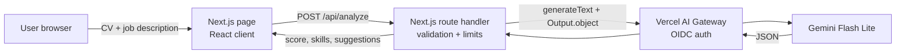

# AI CV Analyzer

Paste a CV and a job description, and an LLM returns a **match score (0-100)**, the **matched skills**, the **missing skills** and **3-5 concrete suggestions** to improve the fit.

**Live demo:** https://ai-cv-analyzer.vercel.app

## Features

- Structured output validated with a Zod schema (score, matched skills, missing skills, suggestions)
- Server-side LLM call through the Vercel AI Gateway: no API key in the repo or in the browser (OIDC on Vercel)
- Input length limits (CV 8,000 chars, job 5,000 chars) and a capped output size to keep costs low
- Basic prompt-injection guard: the texts are wrapped in tags and the model is told to ignore instructions inside them
- No database: texts are not stored

## Architecture



## Tech stack

- [Next.js](https://nextjs.org) (App Router) + TypeScript
- [Tailwind CSS](https://tailwindcss.com)
- [AI SDK](https://ai-sdk.dev) (`generateText` with `Output.object`) + [Zod](https://zod.dev)
- [Vercel AI Gateway](https://vercel.com/docs/ai-gateway) with the `google/gemini-3.1-flash-lite` model, or the Gemini API directly via `@ai-sdk/google`
- Deployed on [Vercel](https://vercel.com) (deploys on every push to `main`)

## API

`POST /api/analyze` with `{ "cv": "...", "job": "..." }` returns:

```json
{
  "matchScore": 72,
  "matchedSkills": ["TypeScript", "React"],
  "missingSkills": ["Docker"],
  "suggestions": ["Add a project that uses Docker", "..."],
  "model": "google/gemini-3.1-flash-lite"
}
```

## Running it yourself

Requires Node.js 22+. Run `npm install` and `npm run dev`. Outside Vercel, set `AI_GATEWAY_API_KEY` in `.env.local` (never commit it). The model can be changed with `AI_GATEWAY_MODEL`.

Alternative without the AI Gateway: set `GOOGLE_GENERATIVE_AI_API_KEY` (a free Gemini API key) and the route calls Gemini directly (`gemini-2.5-flash-lite` by default, change it with `GOOGLE_MODEL`).

## License

[MIT](LICENSE)
